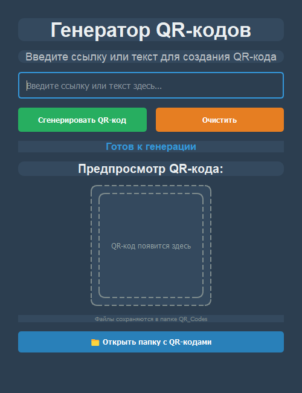

# 📱 QR Generator

Десктопное приложение на PyQt5 для создания QR-кодов. Вставляете ссылку или текст, жмёте кнопку и сразу видите готовый код. Все коды сохраняются в папку `QR_Codes`. Работает без интернета.


| Главное окно | Готовый QR-код |
|---|---|
|  |  |

## Возможности

- QR-код из любой ссылки или текста;
- предпросмотр результата прямо в окне;
- автоматическое сохранение в `QR_Codes/` и кнопка, открывающая эту папку;
- генерация в отдельном потоке (`QThread`), поэтому интерфейс не зависает;
- тёмная тема.

## Установка и запуск

```bash
git clone https://github.com/Naruto456y/qr-generator.git
cd qr-generator
pip install -r requirements.txt
python qr.py
```

## Сборка exe

```bash
pip install pyinstaller
pyinstaller QR_Code.spec
```

Готовый файл появится в `dist/`.

## Структура

```
qr.py           приложение
qr_icon.png     иконка
QR_Code.spec    конфигурация PyInstaller
screenshots/    скриншоты для README
```

## Автор

Yusuf ([@Naruto456y](https://github.com/Naruto456y)). Лицензия [MIT](LICENSE).
